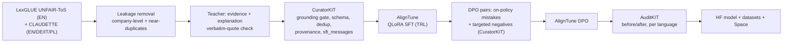

# Smallprint

**Reads the small print, on your device.**

Smallprint is a 3.35B-parameter model, fine-tuned from Cohere Labs **Tiny Aya Water**, that reads Terms of
Service and privacy policies one clause at a time. It flags terms that may be unfair to the consumer and backs
every flag with an exact quote and one plain sentence. It handles English, German, Italian and Polish, and it is
small enough to run on a laptop, so the documents never leave the user's device.

Entry for the [Lexsi AI Safety and Alignment Hackathon](https://hackathon.lexsi.ai/), **Track 1: Fine-tuning
and Data Curation**, problem statements 1 (regulated-domain assistant), 5 (structured output), 3 (grounded
answers), 4 (multilingual), 9 (long documents) and 2 (replacing a closed-model API).

```json
{"unfair": true,
 "categories": ["unilateral_termination"],
 "evidence": "We may suspend or terminate your account at any time without prior notice",
 "explanation": "The company can close your account whenever it wants, without warning you."}
```

## Results

_Filled in from `results/summary.md` after the final run._

| Metric (LexGLUE UNFAIR-ToS test) | Tiny Aya Water, zero-shot | Smallprint (SFT + DPO) |
|---|---:|---:|
| Valid JSON | – | – |
| Unfair-term F1 | – | – |
| Category micro-F1 / macro-F1 | – | – |
| False alarms on fair clauses (lower is better) | – | – |
| Evidence is a real quote | – | – |

Multilingual (CLAUDETTE test companies, EN/DE/IT/PL): see `results/summary.md`.
ROI against a closed-model API: see `results/roi.md`.

## How it works



**Data.** Gold labels come from expert annotations: LexGLUE UNFAIR-ToS (8 unfair-term categories, English) and
the multilingual CLAUDETTE corpus (9 categories, EN/DE/IT/PL, with fairness levels). Both come from the same
CLAUDETTE project, so the same sentences can sit in one dataset's training split and the other's test split.
`scripts/01_build_data.py` removes that leakage before anything else. It drops any multilingual company whose
English text appears in the LexGLUE test set (all four languages, since they are translations), then any
training sentence that near-duplicates a test sentence. Test sets keep their natural class mix. Training data
is balanced to 2 fair clauses per unfair one.

**Grounding.** A teacher model (Aya Expanse 32B by default, used only as a teacher, as the rules allow) writes
the evidence quote and explanation for each unfair training clause. It never changes the expert label. The quote
must appear verbatim in the clause (`smallprint/grounding.py`). CuratorKIT's hallucination gate then checks the
explanation against the clause with a clause-specific judge prompt. When an explanation fails, the expert label
is kept and the text falls back to a template.

**Training.** AlignTune QLoRA SFT on `sft_messages` (TRL backend), then DPO. The DPO pairs combine the SFT
model's own mistakes on training clauses with targeted negatives for the failure modes that matter most in a
consumer tool: made-up quotes, flagging fair clauses, missing unfair ones, wrong category, and non-JSON prose.

**Evaluation.** AuditKIT runs the zero-shot base model and the fine-tuned model on the same test sets with the
same prompt. It scores schema validity, the unfair/fair decision, exact label sets and fabricated quotes, and
records fingerprints, latency and `auditkit.compare` deltas. Corpus-level LexGLUE-style micro/macro F1,
false-alarm and miss rates, grounding rate and per-language scores are computed from the same predictions.

**Long documents.** `smallprint/document.py` splits a policy into sentence-level clauses, runs the model on each,
and builds the report deterministically from the flagged clauses. No second LLM pass means the summary cannot
claim anything a quoted clause doesn't support, and every call stays well inside Tiny Aya's 8K context.

## Quickstart

Open `notebooks/smallprint_colab.ipynb` in Colab or Kaggle (T4 or better). It runs every step below. You need:

1. A Hugging Face token, and the licence accepted on [CohereLabs/tiny-aya-water](https://huggingface.co/CohereLabs/tiny-aya-water) (gated).
2. A Cohere API key for the teacher and judge (`COHERE_API_KEY`). Without one, use `--no-teacher`.

```bash
pip install -e ".[data,train,eval]"
export SMALLPRINT_HUB__USER=your-hf-username
python scripts/01_build_data.py --push        # CuratorKIT data + eval sets
python scripts/05_evaluate.py --skip-final    # "before" numbers for the base model
python scripts/02_train_sft.py --push         # AlignTune QLoRA SFT, then merge
python scripts/03_build_dpo.py                # preference pairs
python scripts/04_train_dpo.py --push         # AlignTune DPO, merge, push final model
python scripts/05_evaluate.py --with-sft      # AuditKIT before/after -> results/summary.md
python scripts/06_roi.py                      # results/roi.md (fill prices in configs first)
```

Every script accepts `--config`. Every config key can be overridden with `SMALLPRINT_<SECTION>__<KEY>`.

## Repository layout

| Path | What it does |
|---|---|
| `smallprint/labels.py` | The 9 categories, LexGLUE/CLAUDETTE mappings |
| `smallprint/prompts.py` | System prompt (same for baseline and fine-tuned), teacher and judge prompts |
| `smallprint/schema.py` | Output JSON schema and a tolerant, strict-validating parser |
| `smallprint/grounding.py` | Verbatim evidence check |
| `smallprint/data.py` | Loaders, leakage removal, balancing, CuratorKIT records |
| `smallprint/teacher.py` | Teacher annotations with retry and template fallback |
| `smallprint/curate.py` | CuratorKIT stages: grounding gate, SFT assembly, DPO assembly |
| `smallprint/evaluate.py`, `metrics.py` | AuditKIT harness and corpus-level metrics |
| `smallprint/document.py` | Clause splitter and grounded document report |
| `smallprint/model.py` | transformers / vLLM / LiteLLM inference backends |
| `smallprint/roi.py` | Closed API vs self-hosted vs on-device cost table |
| `scripts/01..06` | The pipeline |
| `space/` | Gradio demo for Hugging Face Spaces |
| `docs/` | Plan, abstract, write-up, data licences |
| `tests/` | Unit tests plus offline end-to-end runs of CuratorKIT and AuditKIT |

## Submission checklist

- [ ] Public deployment: HF Space `smallprint-demo` (`space/`)
- [ ] Before/after metrics, more than one: `results/summary.md`
- [ ] Write-up (metrics and why, approach, datasets/tasks/models rationale, why it's better in use): `docs/writeup.md`
- [ ] ROI comparison: `results/roi.md`
- [ ] Abstract under 500 words: `docs/abstract.md`
- [ ] Public HF model collection: `smallprint-tiny-aya-water-3b` (+ SFT adapter)
- [ ] Public HF dataset collection: `smallprint-clauses-4lang`, `smallprint-preferences`, `smallprint-eval`
- [ ] GitHub repo with reproducibility notes: this README
- [ ] Registration email, Track 1, problem statements 1, 5, 3, 4, 9, 2

## Reproducibility

- Seeds are fixed in `configs/smallprint.yaml` (`seed: 42`). The data split, balancing, DPO sampling and eval subsampling all use it.
- CuratorKIT writes `manifest.json`, `lexsi_provenance.json` and `checksums.txt` with each dataset. AuditKIT gives each eval run a fingerprint (stored in `results/*.json`).
- `data/build_report.json` records what leakage removal dropped and where every annotation came from (teacher, template, or template after the gate).
- `pytest` runs offline in seconds. It includes an end-to-end run of steps 1 and 3 through the real CuratorKIT code and an AuditKIT eval with a stub model.

## Licences

Code: MIT. Model: CC BY-NC 4.0 (inherited from Tiny Aya; follow Cohere Labs' Acceptable Use Policy).
Datasets: non-commercial (CLAUDETTE multilingual corpus is CC BY-NC 2.5). Details in `docs/data-licences.md`.
CuratorKIT and AuditKIT are source-available under Lexsi Labs' LSAL (non-commercial).

**Smallprint is not legal advice.** It points at clauses worth reading; it does not tell anyone what to do about them.
